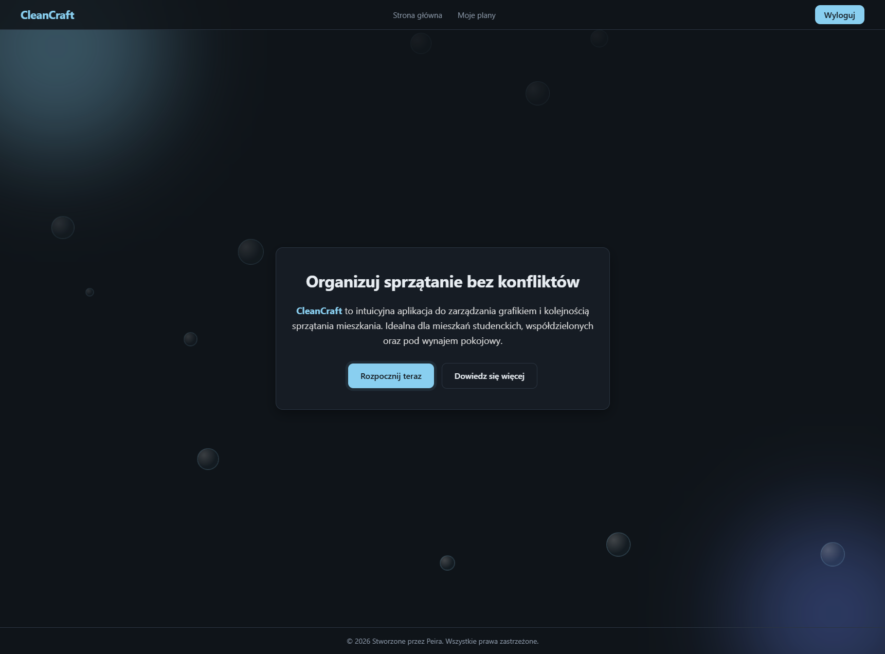
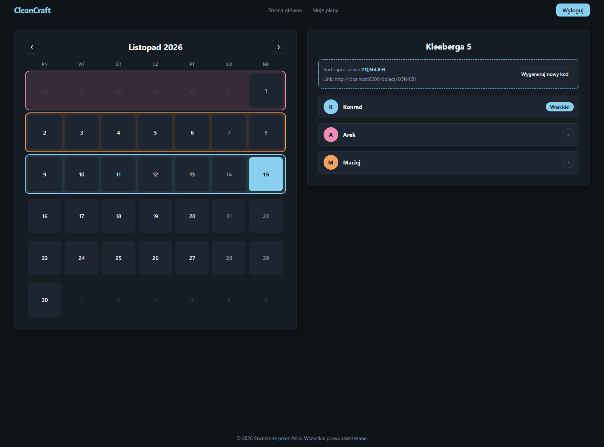

# CleanCraft

Aplikacja webowa do organizowania kolejności sprzątania części wspólnych w mieszkaniach studenckich i wynajmowanych pokojowo. Właściciel planu przydziela tygodnie lokatorom, a każdy widzi w kalendarzu, czyja jest kolej.




## Funkcje

- Rejestracja i logowanie
- Tworzenie planów i dołączanie do nich kodem lub linkiem zaproszeniowym
- Kalendarz miesięczny z przydziałami tygodniowymi (obwódka i tło w kolorze dyżurnego)
- Unikalny kolor każdego lokatora, taki sam na awatarze i w kalendarzu
- Role w planie: właściciel zarządza przydziałami i członkami, członek tylko przegląda
- Usuwanie członków, opuszczanie planu, generowanie nowego kodu zaproszenia
- Responsywny, ciemny interfejs z animowaną stroną główną

## Technologie

- PHP 8.1+ (bez frameworka), własny router i architektura MVC
- MySQL / MariaDB, PDO
- Composer (autoloading PSR-4)
- Czysty JavaScript, HTML, CSS (bez bibliotek)

## Bezpieczeństwo

- Zapytania przygotowane (PDO, `ATTR_EMULATE_PREPARES = false`)
- Hasła przez `password_hash()` / `password_verify()`
- Ochrona CSRF dla wszystkich tras POST, weryfikowana centralnie w routerze
- Limity prób (logowanie, rejestracja, zgadywanie kodów) zapisywane w bazie
- Kontrola dostępu po stronie serwera: członkostwo w planie i rola właściciela
- Ucieczka danych wyjściowych (`htmlspecialchars`), flagi ciasteczka sesji, `session_regenerate_id`
- Kody zaproszeń generowane przez `random_int()`
- Link zaproszeniowy nie zmienia danych przy samym wejściu, dołączenie wymaga potwierdzenia (POST)

## Struktura

```
src/
  Controllers/   kontrolery (Auth, Plan, Home)
  Models/        User, Plan, Schedule, LoginAttempt
  Router.php     routing z parametrami, CSRF dla POST
  Csrf.php, ErrorPage.php
Config/          klasa Database + przykładowa konfiguracja
migrations/      migracje SQL
views/           szablony PHP i partiale
public/          index.php, css, js
migrate.php      prosty runner migracji
```

## Uruchomienie lokalnie

1. Sklonuj repozytorium i zainstaluj zależności:
   ```bash
   composer install
   ```
2. Skopiuj konfigurację bazy i uzupełnij dane:
   ```bash
   cp Config/database.config.example.php Config/database.config.php
   ```
3. Utwórz bazę:
   ```sql
   CREATE DATABASE clean_craft CHARACTER SET utf8mb4 COLLATE utf8mb4_unicode_ci;
   ```
4. Uruchom migracje:
   ```bash
   php migrate.php
   ```
5. Wystartuj serwer i otwórz `http://localhost:8000`:
   ```bash
   composer start
   ```

## Plany rozwoju

- Konkretne zadania (kuchnia, łazienka, śmieci) i automatyczna rotacja
- Usuwanie konta, przekazanie własności planu
- Przypomnienia o dyżurze
- Nagłówki bezpieczeństwa, wygasanie sesji, tryb produkcyjny
- Refaktoryzacja: klasa bazowa kontrolera, wspólny layout widoków

## Autor

Peira